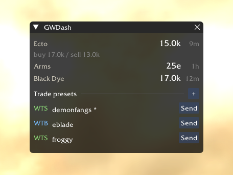
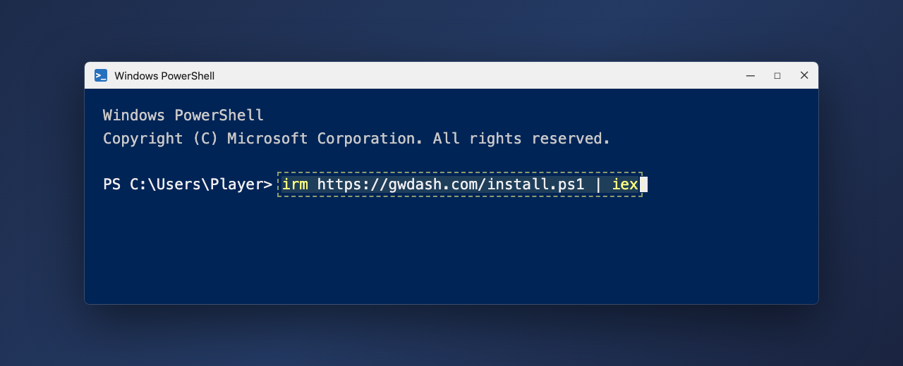
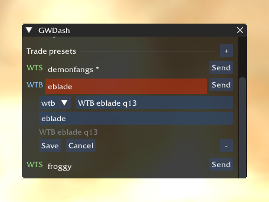

<div align="center">

# GWDash plugin for GWToolbox++

**Live Ecto, Armbrace and Black Dye prices inside Guild Wars, plus one-click trade presets.**

[](https://github.com/jkr-137/gwdash-plugin/releases/latest)
[](https://github.com/jkr-137/gwdash-plugin/actions/workflows/build.yml)
[](https://github.com/jkr-137/gwdash-plugin/releases)
[](https://www.gwtoolbox.com/)
[](LICENSE)



<sub>Prices come from <a href="https://gwdash.com">gwdash.com</a> and refresh every two minutes.</sub>

</div>

## Install in 2 minutes

You need [GWToolbox++](https://www.gwtoolbox.com/) already working in Guild Wars. That's all.

1. **Close Guild Wars.**
2. **Open Windows PowerShell:** press the <kbd>Windows</kbd> key, type `PowerShell` and click **Windows PowerShell**.
   > ⚠️ It has to be **PowerShell**. The black *Command Prompt* (`cmd`) does not understand this line and shows *"'irm' is not recognized…"*.
3. **Paste this line and press <kbd>Enter</kbd>:**

   ```powershell
   irm https://gwdash.com/install.ps1 | iex
   ```

   Copy it with the button on the right of the box, then right-click inside PowerShell (or press <kbd>Ctrl</kbd>+<kbd>V</kbd>) to paste.

   

4. **Start Guild Wars.** The GWDash window shows up on its own. If it doesn't, enable it once under **Toolbox → Settings → Plugins → GWDash.dll → Load**.

No admin rights needed. The script downloads the plugin from this repository's [releases](https://github.com/jkr-137/gwdash-plugin/releases/latest) into your Toolbox `plugins` folder and switches it on in Toolbox's plugin list. Nothing else on your PC is touched ([read the script](https://gwdash.com/install.ps1)).

**Updating:** nothing to do. New versions download in the background and activate the next time you start Guild Wars.

## What you get

| | |
|---|---|
| 💰 **Live prices** | Ecto (NPC trader), Armbrace of Truth and Black Dye from trade chat, the same values as [gwdash.com](https://gwdash.com). Old prices turn yellow. |
| 📣 **Trade presets** | Save up to 12 `WTB` / `WTS` / `WTT` lines. **Send** posts one to trade chat and copies it to the clipboard. |
| ✏️ **Edit in place** | `+` adds a preset, click a name to change it, `−` deletes it, right in the overlay. |
| 🔄 **Auto-update** | Signed releases install themselves on the next game start. |
| 🪟 **Your layout** | Drag and resize the window, single-line mode, font size and background opacity. |

<div align="center">

</div>

## Using it

### Trade presets

- **Add:** click **+** next to *Trade presets*, pick `wtb` / `wts` / `wtt`, type the message and a short name, **Add**.
- **Edit:** click a preset's name to change kind, message or name, then **Save**.
- **Delete:** open it and click **−** twice (the second click within 3 seconds confirms).
- **Send:** posts the line to trade chat once and copies it to the clipboard, so <kbd>Ctrl</kbd>+<kbd>V</kbd> pastes it again. Works in outposts; elsewhere the button says **Copy** and only copies. There is a 3-second cooldown.
- **Want it in the arrow-up history?** Turn on **Send via chat box** under *Settings → Plugins → GWDash*. Send then fills Guild Wars' own chat box and you press <kbd>Enter</kbd>; afterwards <kbd>↑</kbd> brings the line back. Keep the chat box on the trade channel (`$`).

Presets are stored on your PC in `plugins/GWDash/presets.json`. Settings also has import/export, reorder, duplicate and a default preset for an optional hotkey.

### Chat commands

| Command | Does |
|---|---|
| `/gwdash` | Show or hide the overlay |
| `/gwdash prices` | Print the current prices to chat |
| `/gwdash refresh` | Fetch prices now |
| `/gwdash presets` | List your presets |
| `/gwdash send <name>` | Send a preset by name |
| `/gwdash update` · `/gwdash version` | Check for updates · show the version |

## Troubleshooting

<details>
<summary><b>"'irm' is not recognized as an internal or external command"</b></summary>

You are in the Command Prompt (`cmd`). Close it, open **Windows PowerShell** instead (step 2 above) and paste the line again.
</details>

<details>
<summary><b>The overlay doesn't appear</b></summary>

- In Toolbox go to **Settings → Plugins** and click **Load** next to `GWDash.dll`.
- Make sure the *Plugins* feature is enabled in Toolbox (**Settings → Enable the following features**).
- Type `/gwdash` in chat: the window may just be hidden.
</details>

<details>
<summary><b>Windows Defender blocked or deleted the DLL</b></summary>

The DLL is not code-signed yet, and Defender sometimes quarantines unsigned Toolbox plugins. Allow the file in *Windows Security → Protection history*, then run the install line again.
</details>

<details>
<summary><b>The Send button says "Copy"</b></summary>

Trade chat only works in outposts. Outside one the button copies the line so you can paste it later.
</details>

<details>
<summary><b>Uninstall</b></summary>

Run this in Windows PowerShell:

```powershell
iex "& { $(irm https://gwdash.com/install.ps1) } -Uninstall"
```
</details>

<details>
<summary><b>Manual install (without the script)</b></summary>

1. Download `GWDash.dll` and `GWDash.core.dll` from the [latest release](https://github.com/jkr-137/gwdash-plugin/releases/latest).
2. Put them here:

   ```
   %USERPROFILE%\Documents\GWToolboxpp\<COMPUTERNAME>\plugins\GWDash.dll
   %USERPROFILE%\Documents\GWToolboxpp\<COMPUTERNAME>\plugins\GWDash\GWDash.core.dll
   ```

   `scripts/open-plugins-folder.bat` opens that folder for you.
3. Close Guild Wars first if it is running (Windows locks a loaded DLL).
4. Start the game, then **Settings → Plugins → Load**.
</details>

Still stuck? [Open an issue](https://github.com/jkr-137/gwdash-plugin/issues/new/choose).

## Safety notes

- **ArenaNet does not permit third-party plugins.** Toolbox itself prints that warning the first time any plugin is loaded. Use at your own risk.
- Trade-preset **Send** is a convenience for a single, user-initiated chat line — do not use it to spam or automate trade chat.
- The DLL is currently **unsigned** (Authenticode). Windows Defender occasionally quarantines unsigned Toolbox plugins — if Load fails with a virus error, allow the file and try again.
- While any plugin is loaded, Toolbox refuses to write a crash dump. Do not report Toolbox crashes that happen with GWDash loaded.

---

## For developers

### Requirements

- Windows, 32-bit Guild Wars
- [GWToolbox++](https://www.gwtoolbox.com/) with the **Plugins** module enabled
- Built against Toolbox `8.34_Release` (the plugin interface, ImGui `v1.92.7-docking` and the GWCA calls it uses are unchanged since `8.32_Release`)

### Where the prices come from

The plugin polls a static JSON snapshot at `https://data.gwdash.com/prices.json`. That file is written by the GWDash Cloudflare Worker every two minutes into a public R2 bucket and served from Cloudflare's CDN. The request never hits a Worker and never touches D1, so plugin traffic does not consume the free-tier request budget.

If the CDN is unreachable, the plugin falls back to `https://gwdash.com/api/plugin/prices` (edge-cached, ETag).

### How Send works

- The chat line is composed as `kind` + message (unless the message already starts with `wtb`/`wts`/`wtt`).
- Direct mode calls `GW::Chat::SendChat('$', ...)` once (outpost only, 3s cooldown) and copies the line. It bypasses the chat input, so it does not reach the arrow-up history.
- *Send via chat box* opens the chat input (`Keypress(ControlAction_OpenChat)` unless already typing) and appends the line with `kAppendMessageToChat`; the player posts it with Enter.
- The optional send hotkey asks for confirmation, because it fires even while typing. `/gwdash send <name>` sends without a dialog.
- If `presets.json` fails to parse, saving is blocked until you **Reset presets**.

### Auto-update

`GWDash.dll` is a tiny loader. The real plugin lives one directory down as `GWDash.core.dll`. On start the loader swaps in anything waiting in `GWDash/pending/`, then forwards to the payload. That is how a new version can install itself without fighting the Windows file lock on the DLL Toolbox has loaded.

The updater only talks HTTPS to an allowlisted set of hosts (`api.github.com`, `github.com`, `objects.githubusercontent.com`, `release-assets.githubusercontent.com`, plus the price CDN hosts). Redirects are followed only while the next host stays on that allowlist. ETags are sanitized before being echoed as `If-None-Match`. Draft/prerelease GitHub releases are ignored.

Each release ships `manifest.json` + `manifest.sig` (ed25519). The plugin verifies the signature against the public key in `src/UpdatePublicKey.h`, then checks the SHA-256 of `GWDash.core.dll` before staging. Releases also attach PDBs for crash triage.

**Trust model:** ed25519 proves the manifest was signed with the release key held as GitHub secret `GWDASH_UPDATE_ED25519_SK`. Generate a keypair with `scripts/generate-update-keys.py`, put the public bytes into `UpdatePublicKey.h`, and store the private seed hex in that secret. Treat a compromised signing key or GitHub account as full RCE in Guild Wars — keep org/2FA/CI secrets locked down.

The loader itself cannot be replaced this way. When a release also changes the loader, the overlay asks you to re-run the installer once.

### Building from source

Needs Visual Studio 2022 (toolset v143+) with the **Desktop development with C++** workload, CMake ≥ 3.29, and [vcpkg](https://vcpkg.io).

```powershell
$env:VCPKG_ROOT = "C:\path\to\vcpkg"
cmake --preset windows-x86 -DGWDASH_VERSION=0.1.0
cmake --build --preset relwithdebinfo
bin\RelWithDebInfo\gwdash_tests.exe
```

Outputs land in `bin/RelWithDebInfo/`:

| File | Role |
|------|------|
| `GWDash.dll` | Loader stub Toolbox sees |
| `GWDash.core.dll` | Overlay, price client, updater |
| `gwdash_tests.exe` | Pure unit tests (no GWCA) |

The build pulls [GWToolbox++](https://github.com/gwdevhub/GWToolboxpp) at the pinned tag `8.34_Release` via FetchContent and reuses its ImGui (with Toolbox's `imconfig.h` — required, the struct layouts differ from stock ImGui), plugin base sources and prebuilt `gwca.lib`. It does **not** build `GWToolboxdll` itself.

### Project layout

```
cmake/ToolboxSdk.cmake   FetchContent + plugin_base stand-in
compat/                  stubs so we can compile Toolbox sources without linking GWToolboxdll
loader/Loader.cpp        GWDash.dll
src/                     GWDash.core.dll
tests/                   gwdash_tests
vendor/ed25519/          Orson Peters ed25519 (verify/sign)
.github/                 CI build + tagged releases
```

## License

MIT. GWToolbox++ is MIT as well; this plugin is not affiliated with ArenaNet or the GWToolbox++ project. `vendor/ed25519` is zlib (see its LICENSE).
